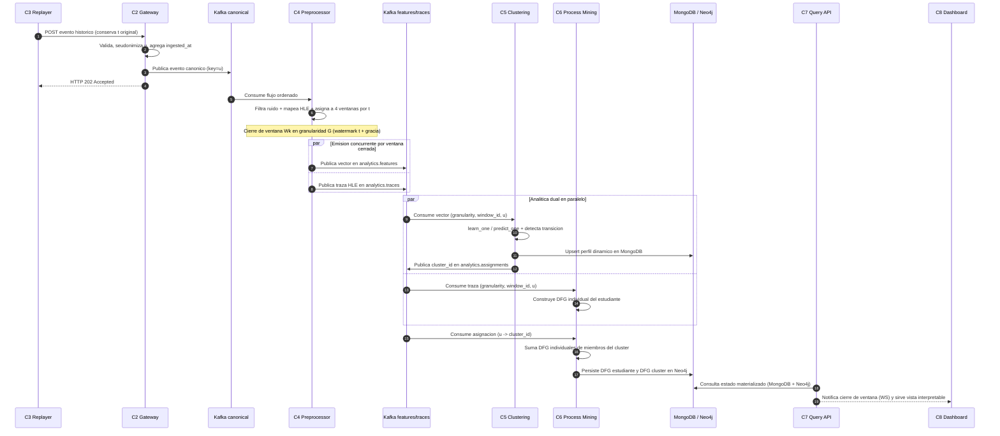

# Arquitectura del Sistema — Modelado Dinámico e Interpretable de Estudiantes en LMS

> **Propósito del documento:** Definir la arquitectura de software, el modelo de datos, los contratos entre servicios, los puntos de extensión y el stack tecnológico que materializan el diseño conceptual de la tesis *«Implementación y validación de la automatización del modelado dinámico e interpretable de patrones de interacción estudiantil en LMS»* ([main.md](./tesis/main.md), Capítulo III). Este documento funge además como base técnica para la redacción del Capítulo IV de la tesis.
>
> **Nota de sincronización documental:** `docs/tesis/main.md` es una copia de referencia que se sincroniza manualmente desde el repositorio de la tesis; por ello, este documento cita siempre por **sección** de la tesis y nunca por número de línea.

---

## 1. Introducción y alcance

El objetivo general de la investigación es automatizar el perfilado dinámico de estudiantes a partir de sus interacciones en un Sistema de Gestión de Aprendizaje (LMS) mediante una plataforma de software que integre minería de flujos de datos (*Data Stream Mining*) y minería de procesos educativos (*Educational Process Mining*, EPM), produciendo perfiles interpretables, consistentes y reproducibles ([main.md](./tesis/main.md), Sección I.4).

En el Capítulo III de la tesis (Sección III.1) se definió una **arquitectura unificada tipo Kappa** ([arquitectura_general_kappa.jpg](./diagrams/arquitectura_general_kappa.jpg)) organizada conceptualmente en cuatro estratos:
1. **Telemetría e ingesta continua**, con un registro de eventos inmutable de solo adición (*append-only log*).
2. **Transformación y analítica dual concurrente**, que realiza abstracción semántica a Eventos de Alto Nivel (HLE) sobre ventanas de tiempo disjuntas y ejecuta en paralelo agrupamiento evolutivo y descubrimiento de procesos.
3. **Persistencia de estado operativo**, con almacenamiento híbrido (semiestructurado, basado en grafos y relacional).
4. **Mediación e interpretabilidad**, encargada de proyectar al docente perfiles explicables sin opacidad de caja negra.

Este documento traduce dicho diseño conceptual en una **arquitectura implementable y verificable**, incorporando además la infraestructura transversal necesaria para responder empíricamente las tres preguntas de investigación (latencia de extremo a extremo, interpretabilidad docente y contraste operativo frente al paradigma *batch* tradicional, Sección I.3).

---

## 2. Registro de decisiones de arquitectura (ADR)

Esta sección documenta y justifica cada decisión técnica y estructural del sistema frente a sus alternativas, proporcionando trazabilidad directa entre el diseño conceptual (Capítulo III) y la materialización tecnológica (Capítulo IV).

| ID | Decisión | Componentes afectados | Sección de la tesis relacionada |
| :--- | :--- | :--- | :--- |
| **ADR-00** | Arquitectura unificada tipo Kappa | Plataforma completa | Secciones I.6.1, III.1 |
| **ADR-01** | Replayer de históricos reales como fuente principal | C3, C1 (futuro) | Secciones I.3, III.3.1 |
| **ADR-02** | Backend unificado en Python + FastAPI | C2, C7, `dsm_common` | Sección III.3.1, III.3.3 |
| **ADR-03** | Persistencia políglota con ediciones Community gratuitas | MongoDB, Neo4j, PostgreSQL | Sección III.2.3 |
| **ADR-04** | Motores de clustering intercambiables sobre River | C5, `dsm_core` | Secciones I.4.2, III.3.2.2 |
| **ADR-05** | Catálogo HLE, features y 4 ventanas configurables | C4, `config/`, PostgreSQL | Secciones II.1.3, III.2.1, III.3.2.1 |
| **ADR-06** | Apache Kafka 3.x en modo KRaft sin Zookeeper | Log inmutable / Broker | Sección III.2.2 |
| **ADR-07** | Quix Streams como procesador continuo con estado | C4 | Secciones III.2.1, III.3.2.1 |
| **ADR-08** | Python como lenguaje único del núcleo analítico (River + PM4Py) | C4, C5, C6, C9, `dsm_core` | Secciones II.2.2, II.2.3, III.3.2.2 |
| **ADR-09** | Monorepo gestionado con workspace de `uv` | Repositorio completo | Secciones I.4.2, I.6.1 (reproducibilidad) |
| **ADR-10** | Separación `dsm_common` / `dsm_core` / servicios | `libs/`, `services/`, `experiments/` | Secciones I.3 (P3), III.3 |
| **ADR-11** | Frontend en Vue 3 + PrimeVue + ECharts + Cytoscape.js | C8 | Secciones II.2.3, III.3.3 |
| **ADR-12** | Ventanas por tiempo del evento (`t`) y latencia desde `ingested_at` | C2, C3, C4, C10 | Secciones I.3 (P1), III.2.1 |
| **ADR-13** | DFG aditivo para concurrencia real de la analítica dual | C5, C6 | Sección III.3.2.2 |
| **ADR-14** | Seudonimización HMAC-SHA256 determinista con salt secreta | C2, `dsm_common` | Sección III.2.2 |
| **ADR-15** | Organización de la documentación y citas por sección | `docs/` | Transversal (Capítulo IV) |

---

### ADR-00: Arquitectura unificada tipo Kappa (heredada del Capítulo III)
- **Contexto:** La plataforma debe actualizar perfiles estudiantiles conforme arriban interacciones continuas desde el LMS y, al mismo tiempo, mantener la capacidad de recalcular la historia completa ante cambios de configuración o experimentos comparativos.
- **Decisión:** Adoptar una arquitectura unificada tipo **Kappa**, en la cual la totalidad de los datos —históricos y recientes— se modela como un único flujo continuo, ordenado e inmutable de eventos (*append-only log*), procesado por una sola tubería analítica.
- **Alternativas consideradas:**
  - *Arquitectura Lambda (capa batch + capa speed paralelas):* Se descarta por introducir divergencia representativa entre métricas transitorias en línea y recálculos retrospectivos, además de duplicar el mantenimiento del código analítico y elevar el costo temporal de reprocesamiento (Sección III.1).
- **Justificación:** Al suprimir la bifurcación *batch/speed* mediante un log inmutable reproducible, un único motor analítico garantiza consistencia entre el estado actual y cualquier reconstrucción histórica.
- **Consecuencias:** Exige un broker basado en log con retención durable (`ADR-06`) y separación estricta entre el registro histórico de solo adición y los almacenes de estado materializado (`ADR-03`).

---

### ADR-01: Reproducción de históricos reales mediante Replayer como fuente principal
- **Contexto:** Actualmente no se dispone de acceso a un servidor Moodle institucional en producción. El director de tesis proveerá un registro histórico de eventos de un curso pasado para validar el sistema con datos reales.
- **Decisión:** El componente **Replayer / Simulador (`C3`)** será el emisor principal de eventos durante el desarrollo y la validación experimental, leyendo el histórico en orden cronológico y enviando peticiones HTTP al Gateway como si ocurrieran en vivo. El conector directo con Moodle vivo (`C1`, vía `logstore_xapi` u *event observer*) queda documentado como extensión futura opcional.
- **Alternativas consideradas:**
  - *Conexión a Moodle institucional en vivo:* Inviable porque no existe acceso al entorno productivo institucional.
  - *Moodle desplegado en Docker con actividad simulada manualmente:* Genera datos artificiales que no reflejan hábitos reales, pausas naturales ni picos de concurrencia de estudiantes auténticos.
  - *Dataset público OULAD:* No proviene de Moodle, no corresponde al curso objetivo de la investigación y reporta clics agregados por día en lugar de secuencias individuales con marca temporal exacta para minería de procesos.
  - *Importación batch estática directa del archivo histórico:* Contradice el paradigma de flujos continuos (*data streams*) que la tesis busca automatizar y evaluar.
- **Justificación:** Permite utilizar datos estudiantiles reales haciéndolos llegar como un flujo continuo al Gateway, con velocidad configurable y repetibilidad exacta para medir latencia (RF-18) y reproducibilidad (RF-19).
- **Consecuencias:** Desacopla el desarrollo y las pruebas de rendimiento de un LMS en vivo y obliga a implementar una interfaz `SourceParser` enchufable en `C3` hasta conocer el formato definitivo del archivo histórico.

---

### ADR-02: Unificación del backend en Python + FastAPI
- **Contexto:** El núcleo analítico depende de bibliotecas científicas maduras disponibles en Python (`River`, `PM4Py`, `Quix Streams`). Existía una prueba exploratoria previa en Node.js/Express (`src/1_ingestion`), considerada código desechable.
- **Decisión:** Descartar el prototipo inicial en Node.js y construir tanto el *Ingestion Gateway* (`C2`) como la *Query API* (`C7`) en **Python con FastAPI y Pydantic**.
- **Alternativas consideradas:**
  - *Mantener Node.js/Express en el Gateway:* Rompe la unificación lingüística con el núcleo Python y obliga a duplicar la definición y validación del esquema del evento canónico en dos lenguajes.
  - *Flask:* Carece de asincronía nativa de alto rendimiento, validación tipada integrada y generación automática de contratos OpenAPI/WebSocket modernos.
  - *Django / Django REST Framework:* Demasiado pesado y acoplado a su propio ORM para servicios que actúan como puerta de ingesta sin estado o API de lectura sobre almacenamiento políglota.
- **Justificación:** FastAPI ofrece ejecución asíncrona nativa, comparte los modelos Pydantic directamente con `dsm_common`, autogenera documentación OpenAPI útil para documentar contratos en la tesis y soporta WebSockets de forma nativa para notificaciones en tiempo real hacia el dashboard.
- **Consecuencias:** Todo el backend comparte un único lenguaje, librería de esquemas y cadena de herramientas (`uv`, `ruff`, `pytest`).

---

### ADR-03: Persistencia políglota con ediciones gratuitas / Community (MongoDB + Neo4j + PostgreSQL)
- **Contexto:** La Sección III.2.3 de la tesis formaliza tres modelos de datos complementarios para el almacén de estado operativo: semiestructurado para perfiles dinámicos (III.2.3.1), topológico basado en grafos para modelos de procesos (III.2.3.2) y relacional normalizado para metadatos institucionales y configuración (III.2.3.3).
- **Decisión:** Utilizar **MongoDB Community**, **Neo4j Community** (licencia GPLv3) y **PostgreSQL**, desplegados en contenedores Docker con esquemas simples por entidad (sin *sharding*, réplicas ni *clustering* multi-base de datos).
- **Alternativas consideradas:**
  - *PostgreSQL único con columnas JSONB + extensión de grafos Apache AGE:* Reduce el número de motores desplegados, pero se aleja del modelo híbrido explícitamente defendido en la Sección III.2.3 y Apache AGE posee menor madurez de herramientas, documentación y expresividad en Cypher frente a Neo4j.
  - *Solo MongoDB:* Obligaría a serializar grafos de proceso como listas de adyacencia dentro de documentos, perdiendo capacidades nativas de consulta topológica de rutas y subgrafos.
- **Justificación:** Mantiene fidelidad estricta al diseño del Capítulo III con costo cero de licenciamiento, configuración sencilla dentro de un único `docker-compose.yml` y especialización óptima para cada tipo de consulta docente.
- **Consecuencias:** La limitación de Neo4j Community (una sola base de datos activa por instancia) se resuelve aislando corridas, cursos, granularidades y ventanas mediante propiedades indexadas en las relaciones (`run_id`, `course_id`, `granularity`, `window_id`).

---

### ADR-04: Motores de clustering intercambiables mediante interfaz común sobre River
- **Contexto:** Los algoritmos definitivos de agrupamiento evolutivo sobre flujos continuos aún están sujetos a confirmación metodológica durante el desarrollo de la investigación.
- **Decisión:** Abstraer el motor de clustering bajo una interfaz común (`ClusteringAlgorithm`) y un registro declarativo en `dsm_core`, implementando inicialmente adaptadores sobre **River** para **DenStream** (algoritmo principal) y **DBSTREAM** (algoritmo de comparación).
- **Alternativas consideradas:**
  - *scikit-multiflow:* Proyecto descontinuado cuyo desarrollo se fusionó oficialmente dentro de River.
  - *MOA (Massive Online Analysis):* Escrito en Java; su integración con el resto del pipeline analítico en Python requeriría puentes JVM o procesos externos complejos.
  - *Implementación propia desde cero:* Costosa en tiempo de desarrollo, propensa a errores numéricos y difícil de defender frente a implementaciones de referencia auditadas en la literatura.
- **Justificación:** Al no estar cerrados los algoritmos finales, encapsular River detrás de una interfaz y una fábrica permite incorporar nuevos algoritmos (como `CluStream` u otro propuesto por la dirección) añadiendo un archivo adaptador y una línea en el registro, sin alterar la ingesta, el preprocesamiento, la persistencia ni la interfaz visual.
- **Consecuencias:** Exige definir un contrato uniforme para entrenamiento incremental (`learn_one`), inferencia (`predict_one`) y serialización interpretable de micro-clústeres (`snapshot`).

---

### ADR-05: Catálogo HLE, vector de características y cuatro ventanas configurables
- **Contexto:** Ni el catálogo definitivo de Eventos de Alto Nivel (HLE) ni la lista cerrada de características del vector por estudiante han sido confirmados aún. Además, se requiere observar la evolución conductual en cuatro granularidades simultáneas: **diaria, semanal, mensual y por curso**.
- **Decisión:** Externalizar las reglas de mapeo HLE, la lista de extractores activos y las definiciones de ventana en archivos YAML versionados dentro de `config/` con valores provisionales, ejecutando en paralelo las cuatro granularidades disjuntas (`daily`, `weekly`, `monthly`, `course`).
- **Alternativas consideradas:**
  - *Codificar reglas HLE y características directamente en código fuente:* Obligaría a modificar y redesplegar servicios cuando se confirmen las definiciones pedagógicas y dificultaría registrar exactamente qué versión produjo cada experimento.
- **Justificación:** Permite iniciar la implementación de punta a punta de inmediato, comparar distintas configuraciones de HLE o características sin tocar código productivo y guardar una copia inmutable de la configuración usada por cada `run_id` en PostgreSQL (RF-19).
- **Consecuencias:** Introduce una capa de validación al arranque mediante modelos Pydantic y obliga a etiquetar cada salida analítica con `(granularity, window_id)` y versiones de catálogo.

---

### ADR-06: Apache Kafka 3.x en modo KRaft (sin Zookeeper)
- **Contexto:** La arquitectura Kappa exige un registro inmutable de solo adición capaz de almacenar todo el historial de eventos, preservar orden causal por estudiante y permitir reproducción desde cualquier *offset* temporal.
- **Decisión:** Emplear **Apache Kafka 3.x en modo KRaft** usando la imagen oficial `apache/kafka`, eliminando Apache Zookeeper.
- **Alternativas consideradas:**
  - *RabbitMQ:* Broker tradicional orientado a colas donde los mensajes se eliminan tras ser confirmados por el consumidor; no funciona como log histórico reproducible y viola el principio central de Kappa.
  - *Redpanda:* Compatible con el protocolo Kafka y ligero, pero distribuido bajo licencia Source-Available (BSL) en lugar de una licencia completamente abierta sin restricciones comerciales.
  - *Apache Pulsar:* Agrega mayor complejidad operativa al requerir BookKeeper y metadatos distribuidos adicionales innecesarios para este proyecto.
  - *Kafka con Zookeeper (como en el Compose exploratorio inicial con imágenes Bitnami):* Zookeeper quedó obsoleto desde Kafka 3.5 y fue eliminado en Kafka 4.0; además, las imágenes Bitnami cambiaron sus condiciones de disponibilidad gratuita.
- **Justificación:** Ofrece un log *append-only* con retención infinita configurable (`retention.ms=-1`), particionamiento por clave `u` para mantener el orden secuencial de cada alumno y soporte estándar de *replay* por *offset* en un solo contenedor.
- **Consecuencias:** Simplifica el archivo `docker-compose.yml`, reduce el consumo de memoria RAM y acelera el arranque local.

---

### ADR-07: Quix Streams como motor de procesamiento continuo
- **Contexto:** El componente `C4 Preprocessor` necesita consumir continuamente el log de Kafka, gestionar ventanas disjuntas basadas en el tiempo del evento con tolerancia a eventos tardíos y persistir su estado intermedio sin perder datos ante reinicios.
- **Decisión:** Adoptar **Quix Streams** (biblioteca Python nativa sobre Kafka con estado local respaldado por RocksDB).
- **Alternativas consideradas:**
  - *Apache Flink / PyFlink:* Motor de gran potencia, pero exige levantar un clúster JVM dedicado (JobManager + TaskManager) con alta complejidad y huella de memoria para un entorno de investigación de un nodo.
  - *Spark Structured Streaming:* Opera bajo un modelo *micro-batch* (mayor latencia base) y también depende de JVM.
  - *Kafka Streams:* Disponible únicamente para Java/JVM, incompatible con la unificación en Python.
  - *Faust:* El proyecto original en Python se encuentra abandonado (solo sobrevive un *fork* comunitario con adopción limitada).
  - *Bytewax:* Opción viable en Python/Rust, pero con menor madurez de integración nativa directa para flujos y ventanas estilo Kafka que Quix Streams.
- **Justificación:** Se ejecuta como un servicio Python estándar, ofrece ventanas *tumbling* nativas por tiempo del evento con periodo de gracia y respalda el estado de ventanas en RocksDB de manera transparente.
- **Consecuencias:** Mantiene baja la complejidad de despliegue y conserva toda la tubería de preprocesamiento dentro del ecosistema Python.

---

### ADR-08: Python como lenguaje único del núcleo analítico (River + PM4Py)
- **Contexto:** El núcleo de la tesis combina *Data Stream Clustering* y *Educational Process Mining* de forma concurrente y reproducible.
- **Decisión:** Estandarizar todo el núcleo analítico (`dsm_core`, servicios `C4`, `C5`, `C6` y módulo experimental `C9`) en **Python**, apoyándose en **River** para clustering en flujo y **PM4Py** para descubrimiento de procesos y cálculo de métricas.
- **Alternativas consideradas:**
  - *ProM:* Herramienta referente en minería de procesos, pero diseñada como aplicación de escritorio Java y no como biblioteca embebible en un servicio automatizado de flujos.
  - *bupaR:* Ecosistema robusto en lenguaje R, cuya integración en un pipeline orientado a eventos de baja latencia sobre Kafka resulta compleja frente a Python.
- **Justificación:** `PM4Py` es el estándar académico de facto en Python para minería de procesos y provee nativamente grafos DFG, *Heuristic Miner* y métricas de *fitness* y *precision* exigidas en RF-21, complementando naturalmente a `River` y `scikit-learn`.
- **Consecuencias:** Permite compartir exactamente la misma implementación algorítmica entre la tubería en flujo (`C4`–`C6`) y el módulo de experimentación comparativa (`C9`).

---

### ADR-09: Monorepo con workspace de `uv`
- **Contexto:** La arquitectura del sistema comprende dos librerías compartidas (`dsm_common`, `dsm_core`), seis servicios desplegables independientes y un módulo de experimentos (`C9`), todos escritos en Python. Se requiere reproducibilidad estricta de dependencias tanto en desarrollo local (Windows) como en contenedores de producción/validación (Linux).
- **Decisión:** Organizar el proyecto como un **monorepo Python gestionado mediante un workspace de `uv`** con un único archivo `uv.lock` en la raíz, complementado con `ruff` (linter/formateador) y `pytest` centralizados en el `pyproject.toml` raíz.
- **Alternativas consideradas:**
  - *Poetry:* Soporta gestión de paquetes, pero la resolución de dependencias es sensiblemente más lenta y los workspaces multi-paquete dependen de plugins de terceros.
  - *pip + `requirements.txt`:* Carece de soporte nativo de workspaces y no genera un lockfile determinista sin herramientas externas adicionales (`pip-tools`), complicando los enlaces editables entre servicios y librerías.
  - *Conda:* Produce lockfiles dependientes de la plataforma e imágenes Docker pesadas; no aporta ventajas aquí porque `River`, `PM4Py` y `scikit-learn` ya distribuyen binarios (*wheels*) estándar vía PyPI.

| Criterio | `uv` | Poetry | `pip` + `requirements.txt` | Conda |
| :--- | :--- | :--- | :--- | :--- |
| Monorepo / workspaces | Nativo (`uv.lock` único y librerías locales enlazadas) | Solo con plugins de terceros | Manual (`-e ../libs/...`) | No soporta |
| Lockfile reproducible multiplataforma | Mismo lock en Windows (desarrollo) y Linux (Docker) | Sí | Requiere `pip-tools` | Lock por plataforma |
| Velocidad de resolución e instalación | Muy rápido (10–100× frente a pip) | Lento | Medio | Lento |
| Gestión de versión de Python | `uv python install 3.12` | Requiere `pyenv` | Requiere instalación manual | Sí |
| Estándar `pyproject.toml` (PEP 621) | Sí | Sí (desde v2) | No aplica | Usa `environment.yml` |
| Integración con Docker | Imagen oficial; `uv sync --frozen` instala el lock exacto | Sí | Parcial | Imágenes pesadas |

- **Justificación:** Un único `uv.lock` fija las versiones exactas de `River`, `PM4Py`, `Quix Streams` y `scikit-learn` para todo el sistema, garantizando la reproducibilidad científica del entorno (RF-19) en Windows y Linux mediante `uv sync --frozen`. Además, cada servicio declara únicamente sus dependencias reales (por ejemplo, el Gateway no instala `PM4Py`).
- **Consecuencias:** Como riesgo, `uv` es una herramienta reciente (2024) mantenida por Astral; sin embargo, al apoyarse en el estándar `pyproject.toml` (PEP 621), migrar en el futuro hacia Poetry o `pip` tendría un costo mínimo.

---

### ADR-10: Separación `dsm_common` / `dsm_core` / servicios
- **Contexto:** El sistema debe ejecutar los mismos cálculos analíticos (filtrado, mapeo a HLE, ventanas, extracción de características, clustering y descubrimiento de procesos) tanto en la tubería de flujo en vivo sobre Kafka como en las corridas experimentales y de línea base *batch* (Pregunta 3).
- **Decisión:** Dividir el código compartido en dos librerías con dirección estricta de dependencias (`services → dsm_core → dsm_common`; `experiments → dsm_core`):
  - **`dsm_common`**: Infraestructura transversal (esquemas Pydantic, carga de YAML, seudonimización, mensajería Kafka, clientes de bases de datos, observabilidad).
  - **`dsm_core`**: Dominio analítico puro (preprocesamiento/HLE, ventanas, extractores de características, algoritmos de clustering, minería de procesos y explicabilidad). **`dsm_core` nunca importa Kafka ni bases de datos.**
  - **`services/`**: Cascarones delgados de entrada/salida que conectan Kafka, HTTP o bases de datos con funciones puras de `dsm_core`.
- **Alternativas consideradas:**
  - *Una sola librería compartida:* Más simple inicialmente, pero mezcla lógica matemática con clientes de infraestructura y obliga a cualquier módulo de pruebas o servicio liviano a arrastrar dependencias pesadas innecesarias.
  - *Lógica analítica implementada dentro de cada servicio:* Provocaría duplicación inevitable entre la tubería *stream* y los experimentos *batch*, introduciendo riesgo de sesgos metodológicos al comparar ambos paradigmas.
- **Justificación:** Asegura una comparación justa *batch* vs. *stream* (RF-20) al compartir exactamente el mismo mapeo HLE, ventanas y features; permite a `experiments` reproducir el flujo en memoria sin levantar Kafka (RF-19); habilita pruebas unitarias rápidas en milisegundos sin contenedores; y facilita agregar nuevos algoritmos o extractores de forma aislada.
- **Consecuencias:** Exige disciplina de diseño para mantener la capa de dominio libre de efectos secundarios de red o almacenamiento.

---

### ADR-11: Frontend en Vue 3 + PrimeVue, visualización con ECharts y Cytoscape.js
- **Contexto:** La capa de mediación e interpretabilidad (`C8`) requiere un tablero web con vistas analíticas especializadas: evolución temporal de clústeres (diagramas Sankey/aluviales y dispersión), visor topológico interactivo de grafos DFG y ficha explicable del estudiante, manteniendo bajo esfuerzo de desarrollo frente al núcleo científico.
- **Decisión:** Construir el frontend en **Vue 3 + TypeScript + Vite**, utilizando **Pinia** para estado, **Vue Router** para navegación, **PrimeVue** como biblioteca de componentes de interfaz, **`vue-echarts` (Apache ECharts)** para gráficos estadísticos/Sankey y **Cytoscape.js + `cytoscape-dagre`** para grafos dirigidos de procesos.
- **Alternativas consideradas:**
  - *React:* Ecosistema más grande, pero sin ventajas técnicas reales para las visualizaciones requeridas en este proyecto (véase tabla comparativa).
  - *Angular:* Framework empresarial completo pero excesivamente verboso y pesado para un dashboard de 3 o 4 vistas analíticas.
  - *Svelte:* Ligero y expresivo, pero con un ecosistema mucho más reducido de librerías maduras de componentes empresariales y tablas de datos.
  - *Vuetify / Element Plus (frente a PrimeVue):* Vuetify acopla el diseño a Material Design con mayor peso visual, mientras que Element Plus ofrece menor riqueza en componentes orientados a análisis tabular avanzado frente a PrimeVue (`DataTable` con ordenamiento/filtrado complejo, selectores y paneles).

| Necesidad del dashboard | Alternativa en React | Equivalente en Vue 3 | Veredicto técnico |
| :--- | :--- | :--- | :--- |
| **Grafos de proceso (DFG)** | React Flow | Vue Flow | Ambos están pensados para editores de nodos arrastrables. Para DFG automáticos el estándar es **Cytoscape.js + `dagre`** (layout jerárquico), independiente del framework. |
| **Sankey y evolución de clústeres** | Nivo, Recharts, `visx` | **`vue-echarts` (Apache ECharts)** | ECharts cubre Sankey, series temporales, *heatmaps* y *scatter* de forma unificada en ambos frameworks. |
| **Proyección 2D de clústeres** | ECharts / `visx` | ECharts `scatter` (o `echarts-gl`) | Empate funcional completo. |
| **Rendimiento con grafos grandes** | Canvas de Cytoscape/ECharts | Canvas de Cytoscape/ECharts | El rendimiento depende de la librería gráfica (Canvas/WebGL), no del framework UI. |

- **Justificación:** Ninguna librería exclusiva de React mejora las salidas visuales requeridas; el factor determinante es que el autor posee amplia experiencia previa con Vue, lo que reduce el riesgo de implementación y acelera la construcción del dashboard. PrimeVue aporta componentes de datos completos bajo licencia MIT y tematización flexible.
- **Consecuencias:** La API (`C7`) expone JSON estándar y WebSockets agnósticos al cliente, desacoplados del frontend SPA en `frontend/dashboard/`.

---

### ADR-12: Ventanas por tiempo del evento (`t`) y latencia medida desde `ingested_at`
- **Contexto:** Al reproducir un curso histórico mediante `C3 Replayer` en modo acelerado (`10x`, `100x`, `max`), el ritmo de llegada de eventos al sistema difiere drásticamente del tiempo real transcurrido durante el curso original.
- **Decisión:** Distinguir formalmente dos relojes: (1) toda asignación a ventanas disjuntas (`daily`, `weekly`, `monthly`, `course`) en `C4` se calcula estrictamente sobre el **tiempo del evento (`t`)** original del LMS; (2) toda métrica de desempeño computacional y latencia de la plataforma (RF-18) se mide desde **`ingested_at`** (recepción en `C2`) hasta la persistencia final en MongoDB/Neo4j.
- **Alternativas consideradas:**
  - *Ventanas por tiempo de procesamiento (reloj del servidor al recibir el evento):* Invalidaría las simulaciones históricas aceleradas, pues todos los eventos de un semestre caerían en una sola ventana de pocos minutos, destruyendo la reproducibilidad (RF-19).
- **Justificación:** Garantiza que correr el histórico a `1x` o a `max` genere exactamente las mismas particiones temporales, vectores y clústeres, al mismo tiempo que permite medir objetivamente la latencia real de la tubería de software (Pregunta 1).
- **Consecuencias:** Requiere manejar marcas de agua (*watermarks*) basadas en `t` más un periodo de gracia configurable para el cierre determinista de ventanas.

---

### ADR-13: DFG aditivo para concurrencia real de la analítica dual
- **Contexto:** La Sección III.3.2.2 establece un «modelado concurrente dual» donde el agrupamiento evolutivo y la minería de procesos operan en paralelo sobre el cierre de cada ventana. Sin embargo, para construir el grafo de un clúster hace falta conocer a qué clúster pertenece cada estudiante.
- **Decisión:** Aprovechar que un *Directly-Follows Graph* (DFG) es algebraicamente **aditivo**: `C6` construye inmediatamente el DFG individual de cada estudiante en cuanto recibe su traza en `analytics.traces` (en paralelo con `C5`), y cuando recibe la asignación `cluster_id` desde `analytics.assignments`, suma las frecuencias (`freq`) y tiempos acumulados (`total_time_sec`) de los DFG individuales para materializar el DFG del clúster en Neo4j.
- **Alternativas consideradas:**
  - *Ejecución secuencial estricta (`C5` → `C6` desde trazas crudas):* Serializaría ambos motores obligando a `C6` a esperar a `C5` antes de iniciar y a releer o recomputar todas las trazas de cada clúster desde cero al cierre de ventana.
- **Justificación:** Mantiene concurrencia real entre `C5` y `C6`, reduce la latencia de cierre de ventana al distribuir el cómputo de trazas y preserva exactitud matemática en tiempos medios (`total_time_sec / freq`).
- **Consecuencias:** Exige persistir tanto la suma de tiempos como el conteo (`freq` y `total_time_sec`) en las aristas `:DFG` de Neo4j, además de mantener el DFG individual cuando se requiera aplicar un filtro posterior como *Heuristic Miner*.

---

### ADR-14: Seudonimización HMAC-SHA256 determinista con salt secreta
- **Contexto:** Los registros de interacción estudiantil contienen identificadores institucionales personales que no deben exponerse en claro en logs de mensajería ni en repositorios de estado analítico.
- **Decisión:** Aplicar seudonimización determinista en el borde de entrada (`C2`, mediante utilidad compartida en `dsm_common`) calculando `HMAC-SHA256(salt_secreta, raw_user_id)` truncado antes de publicar en `lms.events.canonical`. La `salt_secreta` reside únicamente en variables de entorno (`.env`) excluidas del control de versiones.
- **Alternativas consideradas:**
  - *Hash simple (`SHA-256` sin clave secreta):* Vulnerable a ataques de diccionario o fuerza bruta cuando los identificadores siguen formatos institucionales predecibles (por ejemplo, matrículas numéricas).
  - *UUID aleatorio por evento o por sesión:* Destruye la continuidad longitudinal del estudiante entre ventanas disjuntas, impidiendo construir su trayectoria evolutiva.
  - *Tabla de mapeo cifrada en base de datos central:* Añade acoplamiento y un punto adicional de riesgo de exposición en tiempo de ejecución.
- **Justificación:** Preserva la identidad analítica consistente de cada estudiante a lo largo de todas las ventanas y granularidades (necesario para RF-12 y `partition_key = u` en Kafka) sin almacenar datos personales identificables.
- **Consecuencias:** Si se requiere asociar un perfil anónimo con un alumno real en una intervención docente futura, será necesario mantener fuera del flujo analítico un mapeo autorizado por la institución o un módulo de resolución restringido en `C7`.

---

### ADR-15: Organización de la documentación y citas por sección
- **Contexto:** El manuscrito de la tesis evoluciona de forma paralela en un repositorio independiente y su copia en este repositorio se actualizará periódicamente, cambiando los números de página y de línea.
- **Decisión:** Alojar la copia de referencia de la tesis en `docs/tesis/` (`main.md`, `main.pdf`), las figuras en `docs/diagrams/` y centralizar **todas** las decisiones arquitectónicas en la Sección 2 de `docs/arquitectura.md` (sin crear una carpeta redundante `docs/adr/`). Todas las referencias cruzadas hacia la tesis citan por número de sección.
- **Alternativas consideradas:**
  - *Mantener archivos individuales en `docs/adr/*.md` y citas por línea (`#L...`):* Dispersa el material necesario para redactar el Capítulo IV y rompe los enlaces cada vez que se sincroniza una nueva versión de `main.md`.
- **Justificación:** Un único documento maestro cohesivo facilita la consulta continua tanto para el desarrollo de software como para la redacción directa del Capítulo IV de la tesis.
- **Consecuencias:** Al sincronizar una nueva versión de la tesis en `docs/tesis/`, únicamente hay que verificar la vigencia conceptual de las secciones referenciadas.

---

## 3. Requerimientos del sistema

### 3.1 Requerimientos funcionales

| Capa | ID | Descripción funcional |
| :--- | :--- | :--- |
| **I. Ingesta** | **RF-01** | Recibir eventos del emisor (Replayer o LMS) de forma asíncrona y no bloqueante mediante endpoint HTTP. |
| | **RF-02** | Validar la estructura entrante y normalizar cada evento a la tupla canónica E = ⟨u, a, r, t, M⟩ junto con metadatos operativos (`event_id`, `ingested_at`, `run_id`). |
| | **RF-03** | Seudonimizar de forma determinista el identificador del estudiante `u` antes de escribir en el log inmutable para proteger su identidad. |
| | **RF-04** | Escribir cada evento válido en el registro continuo inmutable de solo adición (*append-only log*) y enrutar eventos inválidos a una cola de errores (*DLQ*). |
| | **RF-05** | Reproducir logs históricos reales de cursos pasados de Moodle mediante un Replayer (`C3`) con parsers configurables y factor de velocidad ajustable (`1x`, `Nx`, `max`), simulando emisión en tiempo real. |
| **II. Analítica** | **RF-06** | Filtrar ruido operativo del flujo (eventos administrativos, duplicados técnicos o peticiones sin valor pedagógico). |
| | **RF-07** | Mapear acciones atómicas del LMS a **Eventos de Alto Nivel (HLE)** mediante un catálogo de reglas externo y configurable. |
| | **RF-08** | Asignar cada evento simultáneamente a las **ventanas disjuntas activas** (`daily`, `weekly`, `monthly`, `course`) según la estampa temporal original del evento (`t`), aplicando un periodo de gracia para eventos tardíos. |
| | **RF-09** | Al cierre de cada ventana en cada granularidad, calcular el **vector de características** configurable del estudiante. |
| | **RF-10** | Al cierre de cada ventana en cada granularidad, construir la **traza secuencial ordenada** de HLE del estudiante. |
| | **RF-11** | Ejecutar clustering evolutivo incremental por granularidad mediante algoritmo intercambiable, actualizando micro-clústeres/centroides y asignando el perfil actual al estudiante. |
| | **RF-12** | Detectar y registrar las **transiciones de clúster** de cada estudiante entre ventanas consecutivas de una misma granularidad. |
| | **RF-13** | Ejecutar minería de procesos educativa (EPM): generar el grafo de flujo directo (**DFG**) por estudiante al recibir su traza y consolidar incrementalmente el DFG por clúster en cada `(granularity, window_id)` con frecuencias y tiempos medios de transición. |
| **III. Persistencia** | **RF-14** | Persistir de forma desacoplada los perfiles dinámicos en MongoDB, los grafos DFG en Neo4j y los metadatos institucionales/configuraciones de corrida en PostgreSQL. |
| **IV. Presentación** | **RF-15** | Exponer una API de consulta (REST + WebSocket) que lea exclusivamente del estado operativo materializado y nunca del log histórico de Kafka. |
| | **RF-16** | Proveer un dashboard web para el docente con evolución temporal de clústeres (Sankey/aluvial), visualización interactiva de DFG por clúster/estudiante y ficha explicable con justificación estructural del perfil. |
| | **RF-17** | Gestionar autenticación y autorización básica por roles (`docente` y `administrador`). |
| **V. Validación** | **RF-18** | Medir el throughput y la latencia de procesamiento de extremo a extremo desde `ingested_at` hasta la persistencia del estado operativo, desglosada por etapa. |
| | **RF-19** | Garantizar reproducibilidad experimental asociando cada ejecución a un `run_id` con versión exacta de configuración (ventanas, algoritmo, parámetros, semilla, catálogo HLE, features). |
| | **RF-20** | Ejecutar una **línea base batch** sobre el mismo conjunto de datos completo (K-Means + descubrimiento global en PM4Py) para contrastarla frente al modelado en flujo. |
| | **RF-21** | Calcular métricas objetivas de evaluación: Coeficiente de Silueta, estabilidad entre corridas (*Adjusted Rand Index*, ARI) y *Fitness* / *Precision* de los modelos de proceso. |

### 3.2 Requerimientos no funcionales

- **RNF-01 (Baja latencia y desacoplamiento):** La recepción de eventos en `C2` debe responder en milisegundos sin esperar a que terminen los algoritmos de `C5` o `C6`.
- **RNF-02 (Determinismo y reproducibilidad):** La segmentación en ventanas depende exclusivamente de `t` (tiempo del evento) y no del reloj del sistema durante la ejecución acelerada.
- **RNF-03 (Extensibilidad):** El cambio de formato origen, reglas HLE, conjunto de características, algoritmo de clustering o algoritmo de descubrimiento de procesos debe realizarse implementando una interfaz y actualizando configuración YAML.
- **RNF-04 (Soberanía tecnológica y costo cero):** Todos los componentes, motores de bases de datos y bibliotecas deben emplear licencias abiertas o ediciones Community gratuitas.
- **RNF-05 (Despliegue portable):** Toda la plataforma debe poder iniciarse localmente o en un servidor institucional mediante Docker Compose con configuración declarativa.
- **RNF-06 (Privacidad de datos educativos):** El identificador personal del alumno nunca se almacena en claro dentro del log inmutable ni en las colecciones analíticas.

---

## 4. Vista de capas y componentes

### 4.1 Diagrama de arquitectura de software

```mermaid
flowchart LR
    subgraph Capa1["I. Telemetria e Ingesta Continua"]
        C3["C3 Replayer / Simulador (Fuente Principal)"]
        C1["C1 Conector Moodle (Opcional / Futuro)"]
        C2["C2 Ingestion Gateway (FastAPI + Pydantic)"]
        KAFKA_RAW[("Kafka: lms.events.canonical (Append-Only)")]
        KAFKA_DLQ[("Kafka: lms.events.dlq")]
    end

    subgraph Capa2["II. Transformacion y Analitica Dual"]
        C4["C4 Preprocessor (Quix Streams: Filtro + HLE + 4 Ventanas)"]
        KAFKA_FEAT[("Kafka: analytics.features")]
        KAFKA_TRACE[("Kafka: analytics.traces")]
        KAFKA_ASSIGN[("Kafka: analytics.assignments")]
        C5["C5 Clustering Engine (River: DenStream / DBSTREAM)"]
        C6["C6 Process Mining Engine (PM4Py: DFG Aditivo)"]
    end

    subgraph Capa3["III. Persistencia de Estado Operativo"]
        MONGO[("MongoDB Community (Perfiles Dinamicos)")]
        NEO4J[("Neo4j Community (Grafos DFG)")]
        PG[("PostgreSQL (Metadatos y Run Configs)")]
    end

    subgraph Capa4["IV. Mediacion e Interpretabilidad"]
        C7["C7 Query API (FastAPI REST + WebSocket)"]
        C8["C8 Dashboard Docente (Vue 3 + PrimeVue + ECharts + Cytoscape)"]
    end

    subgraph Transversal["V. Validacion y Observabilidad"]
        C9["C9 Experiment Runner (Batch Baseline + Metricas)"]
        C10["C10 Observabilidad (Prometheus + Grafana + Console)"]
    end

    C3 -->|"HTTP POST (t original)"| C2
    C1 -.->|"xAPI HTTP (futuro)"| C2
    C2 -->|"Evento canonico"| KAFKA_RAW
    C2 -->|"Invalido"| KAFKA_DLQ
    KAFKA_RAW -->|"Lectura continua"| C4
    C4 -->|"Vectores por ventana"| KAFKA_FEAT
    C4 -->|"Trazas por ventana"| KAFKA_TRACE
    KAFKA_FEAT --> C5
    KAFKA_TRACE --> C6
    C5 -->|"Asignacion cluster_id"| KAFKA_ASSIGN
    KAFKA_ASSIGN --> C6
    C5 -->|"Upsert perfiles"| MONGO
    C6 -->|"Merge grafos DFG"| NEO4J
    MONGO --> C7
    NEO4J --> C7
    PG --> C7
    C7 -->|"REST / WS"| C8
    PG -.->|"Lee config versionada"| C4
    PG -.->|"Lee config versionada"| C5
    KAFKA_RAW -.->|"Lee historico completo"| C9
    C9 -->|"Guarda metricas batch/stream"| PG
    C2 -.-> C10
    C4 -.-> C10
    C5 -.-> C10
    C6 -.-> C10
```



### 4.2 Catálogo de componentes

| ID | Componente | Estado / Rol | Responsabilidad específica | RF atendidos |
| :--- | :--- | :--- | :--- | :--- |
| **C1** | Conector Moodle | **Opcional / Trabajo futuro** | Plugin `logstore_xapi` o *event observer* en Moodle vivo para emitir sentencias en tiempo real hacia `C2`. No se implementa en la etapa actual. | RF-01 |
| **C2** | Ingestion Gateway | Activo (FastAPI) | Recibe peticiones HTTP de eventos, valida esquemas con Pydantic, seudonimiza `u`, añade `ingested_at` y `event_id`, normaliza a `E = ⟨u, a, r, t, M⟩` y publica en `lms.events.canonical` (o `*.dlq` si falla). | RF-01..04 |
| **C3** | Replayer / Simulador | **Fuente principal actual** | Lee el archivo histórico real del curso en orden cronológico mediante `SourceParser` enchufable (soportando exportación CSV de Moodle y tabla `mdl_logstore_standard_log`). Envía eventos a `C2` a velocidad configurable (`1x`, `Nx` o `max` sin pausas) preservando `t` original. | RF-05, RF-18 |
| **C4** | Preprocessor | Activo (Quix Streams) | Consume el log inmutable, descarta ruido administrativo/técnico, traduce acciones a HLE vía `config/hle_catalog.yaml` y particiona el flujo simultáneamente en 4 ventanas disjuntas (`daily`, `weekly`, `monthly`, `course`) según `t`. Al cierre de cada ventana emite vectores y trazas. | RF-06..10 |
| **C5** | Clustering Engine | Activo (River) | Mantiene instancias independientes del modelo evolutivo por cada `(run_id, granularity)`. Al recibir un vector, actualiza el algoritmo (`DenStream` o `DBSTREAM` u otro registrado), asigna `cluster_id`, detecta transiciones frente a la ventana anterior, persiste el perfil en MongoDB y emite la asignación. | RF-11, RF-12, RF-14 |
| **C6** | Process Mining Engine | Activo (PM4Py) | Al recibir la traza de un estudiante en `analytics.traces`, construye inmediatamente su DFG individual (en paralelo con `C5`). Cuando recibe `analytics.assignments` desde `C5`, agrega aditivamente los DFG individuales de los miembros de cada clúster y persiste ambos niveles (`student` y `cluster`) en Neo4j. | RF-13, RF-14 |
| **C7** | Query API | Activo (FastAPI) | Expone endpoints REST para consultar perfiles, evolución de clústeres, grafos DFG y metadatos de corridas desde MongoDB/Neo4j/PostgreSQL, además de WebSocket para notificar el cierre de ventanas al dashboard. Gestiona JWT/roles. | RF-15, RF-17 |
| **C8** | Dashboard Docente | Activo (Vue 3 SPA) | Interfaz de interpretabilidad con PrimeVue: gráfico Sankey/aluvial de transiciones entre clústeres por granularidad, visor interactivo de grafos DFG con pesos y tiempos, y ficha explicable del estudiante ("por qué está en este clúster"). | RF-16 |
| **C9** | Experiment Runner | Activo (Python CLI) | Orquesta corridas reproducibles (`run_id`), ejecuta la línea base *batch* (K-Means + PM4Py global sobre el log completo) y calcula métricas de comparación (latencia, Silueta, ARI, Fitness, Precision). | RF-19..21 |
| **C10** | Observabilidad | Activo (Infraestructura) | Recolecta métricas Prometheus de cada servicio (latencia por etapa, eventos/s, *consumer lag*), paneles Grafana y visor Kafka (Redpanda Console). | RF-18 |

### 4.3 Gestión temporal: Tiempo del evento (`t`) vs. Tiempo de ingesta (`ingested_at`) y ventanas múltiples

Una distinción crítica de diseño para garantizar la validez experimental (formalizada en **ADR-12**) es separar dos relojes distintos:

1. **Tiempo del evento (`t`):** Estampa cronológica original en la que el estudiante ejecutó la acción dentro del LMS histórico. **Toda la lógica de ventanas disjuntas en `C4` opera estrictamente sobre `t`**. Esto garantiza que ejecutar el `C3 Replayer` a `1x` (tiempo real simulado) o a `100x` (simulación acelerada) produzca exactamente las mismas particiones de ventana, vectores de características, trazas y agrupamientos, asegurando reproducibilidad determinista (RF-19).
2. **Tiempo de ingesta (`ingested_at`):** Instante en el reloj del sistema en que `C2 Ingestion Gateway` recibe el evento. **Toda la medición de latencia computacional (RF-18) se mide desde `ingested_at` hasta la confirmación de persistencia en MongoDB/Neo4j**, nunca desde `t` (que puede datar de meses o años atrás en el histórico).

Respecto a las **cuatro granularidades simultáneas** en `C4`:
- El Preprocessor mantiene cuatro acumuladores de ventanas disjuntas independientes y configurables en `config/windows.yaml`:
  - `daily`: bloques diarios consecutivos (`YYYY-MM-DD`, Δt = 24 h).
  - `weekly`: bloques semanales consecutivos (`YYYY-Www`, Δt = 7 días desde inicio de curso o semana ISO).
  - `monthly`: bloques mensuales (`YYYY-MM` o bloques de 30 días según configuración de curso).
  - `course`: **una única ventana disjunta que abarca la totalidad del curso** (`[course_start, course_end]`). Se cierra al recibir la marca de fin de histórico del Replayer o al superar `course_end` más el periodo de gracia. Esta granularidad actúa como puente analítico directo para contrastar el estado acumulado en flujo continuo frente a la línea base *batch* (Pregunta de investigación 3).
- Cada mensaje emitido hacia `analytics.features`, `analytics.traces` y `analytics.assignments`, así como cada perfil en MongoDB y cada relación en Neo4j, lleva explícitamente la pareja `(granularity, window_id)`.
- El estado algorítmico en `C5` (micro-clústeres y centroides) se mantiene completamente aislado por granularidad, evitando que la densidad de eventos diarios contamine el modelo semanal o mensual.

---

## 5. Flujo de datos de extremo a extremo



> **Concurrencia real de la fase dual:** Como el *Directly-Follows Graph* (DFG) es una estructura aditiva (ADR-13: las frecuencias de transición entre actividades se suman directamente y los tiempos acumulados se combinan mediante suma y conteo), `C6` no espera a `C5` para procesar las trazas. Calcula el grafo por estudiante tan pronto llega la traza y, en cuanto recibe la asignación de clúster desde `C5`, fusiona en memoria o en Neo4j el DFG del alumno dentro del DFG del clúster asignado.

---

## 6. Modelo de datos

### 6.1 Evento canónico ($E = \langle u, a, r, t, M \rangle$)

Todo registro aceptado por `C2` se transforma en un contrato JSON validado por Pydantic antes de entrar al log inmutable:

```json
{
  "event_id": "01935a7f-8c2d-7b1a-9f4e-31c8b92044d1",
  "run_id": "run_2026_11_22_001",
  "u": "usr_7f9c2a8b14e0d3f1",
  "a": "submitted",
  "r": {
    "resource_id": "assign_42",
    "resource_type": "assign",
    "name": "Tarea 3: Arboles de decision"
  },
  "t": "2024-09-18T14:23:11Z",
  "ingested_at": "2026-11-22T21:05:00.142Z",
  "M": {
    "course_id": "course_105",
    "source_format": "moodle_csv",
    "component": "mod_assign",
    "raw_eventname": "\\mod_assign\\event\\assessable_submitted",
    "hle": null,
    "session_hash": "sess_98ab12"
  }
}
```

- `u`: Identificador del estudiante seudonimizado mediante `HMAC-SHA256(salt_secreta, raw_user_id)` truncado (ADR-14), manteniendo consistencia referencial entre ventanas sin exponer identidades reales.
- `t`: Estampa ISO-8601 UTC original de la interacción en el LMS.
- `ingested_at`: Estampa ISO-8601 UTC registrada por `C2` al momento de recibir el evento.

### 6.2 Topics de Kafka

| Topic | Clave de partición | Retención | Productor(es) | Consumidor(es) | Propósito |
| :--- | :--- | :--- | :--- | :--- | :--- |
| `lms.events.canonical` | `u` | Infinita (`retention.ms=-1`) | `C2` | `C4`, `C9` | **Fuente de verdad histórica** inmutable (*append-only*). Particionar por `u` garantiza orden estricto por estudiante. |
| `lms.events.dlq` | `event_id` o `raw` | 30 días | `C2`, `C4` | Auditoría / Admin | Resguardo de eventos malformados o no mapeables para inspección sin detener el flujo. |
| `analytics.features` | `granularity:u` | 7 días | `C4` | `C5` | Vectores de características por estudiante al cierre de cada ventana disjunta. |
| `analytics.traces` | `granularity:u` | 7 días | `C4` | `C6` | Secuencias cronológicas ordenadas de HLE por estudiante al cierre de ventana. |
| `analytics.assignments` | `granularity:window_id` | 7 días | `C5` | `C6`, `C7` | Asignación `(u -> cluster_id)` y eventos de transición de clúster para disparar la agregación DFG y notificaciones WS. |

### 6.3 Esquema semiestructurado en MongoDB Community (Perfiles dinámicos)

Colección principal: `student_profiles` (con índice compuesto único en `{run_id, granularity, window_id, student_id}` y colección auxiliar `cluster_snapshots` para guardar los centroides/micro-clústeres de cada ventana).

```json
{
  "_id": "run_2026_11_22_001:weekly:2024-W38:usr_7f9c2a8b14e0d3f1",
  "run_id": "run_2026_11_22_001",
  "course_id": "course_105",
  "student_id": "usr_7f9c2a8b14e0d3f1",
  "granularity": "weekly",
  "window_id": "2024-W38",
  "window_start": "2024-09-16T00:00:00Z",
  "window_end": "2024-09-23T00:00:00Z",
  "features_version": "v0.1-provisional",
  "features": {
    "total_events": 42,
    "active_days": 5,
    "hle_consulta_recurso_count": 19,
    "hle_participacion_foro_count": 6,
    "hle_envio_tarea_count": 2,
    "hle_intento_cuestionario_count": 3,
    "regularity_index": 0.78,
    "session_count": 7
  },
  "clustering": {
    "algorithm": "denstream",
    "cluster_id": 2,
    "previous_cluster_id": 1,
    "transition_detected": true,
    "distance_to_centroid": 0.34,
    "is_outlier": false
  },
  "explainability": {
    "top_contributing_features": [
      {"feature": "hle_participacion_foro_count", "z_score": 1.42},
      {"feature": "regularity_index", "z_score": 0.95}
    ]
  },
  "latencies_ms": {
    "ingested_to_profile": 38
  },
  "updated_at": "2026-11-22T21:05:00.180Z"
}
```

### 6.4 Esquema topológico en Neo4j Community (Grafos DFG)

En Neo4j Community (base de datos única), se modelan los vértices y aristas del grafo $G = (V, E_g, W)$ definido en la Sección III.2.3.2 de la tesis:

- **Nodos (`:Activity`):** Representan un Evento de Alto Nivel (HLE) dentro de un curso/contexto.
  - Propiedades: `hle_code` (ej. `CONSULTA_RECURSO`), `label`, `category`, `course_id`.
- **Nodos virtuales de inicio y fin (`:Boundary`):** `START` y `END` para identificar explícitamente actividades iniciales y de abandono/cierre en la trayectoria.
- **Relaciones dirigidas (`:DFG`):** Expresan transiciones secuenciales observadas `(:Activity)-[:DFG]->(:Activity)` dentro de una corrida, granularidad y ventana específicas.
  - Propiedades:
    - `run_id`: identificador de ejecución.
    - `course_id`: identificador del curso.
    - `granularity`: `daily` | `weekly` | `monthly` | `course`.
    - `window_id`: identificador de la ventana (ej. `2024-W38`).
    - `scope`: `cluster` | `student` (permite consultar tanto la ruta agregada del clúster como la trayectoria individual del alumno).
    - `scope_id`: `cluster_id` (ej. `"2"`) o `student_id`.
    - `freq`: frecuencia absoluta de la transición $A \to B$.
    - `total_time_sec`: suma acumulada de duración de transición (para mantener aditividad incremental).
    - `mean_time_sec`: tiempo medio de transición en segundos (`total_time_sec / freq`).
    - `support`: proporción de trazas dentro del alcance que contienen esta arista.

### 6.5 Esquema relacional en PostgreSQL (Metadatos institucionales y configuración)

Tablas normalizadas principales:

- **`courses`**: `course_id` (PK), `external_code`, `title`, `start_date`, `end_date`, `metadata_json`, `created_at`.
- **`resources`**: `resource_id` (PK), `course_id` (FK), `external_id`, `resource_type`, `title`, `hle_default_hint`.
- **`users_roles`**: `user_id` (PK), `username`, `password_hash`, `role` (`teacher` | `admin`), `assigned_courses_json`, `created_at` (gestión de acceso al dashboard `C8`, separada del pseudónimo analítico `u`).
- **`hle_catalog_versions`**: `hle_version` (PK), `yaml_hash`, `rules_json`, `is_provisional` (bool), `created_at`.
- **`runs`**: `run_id` (PK), `mode` (`stream` | `batch`), `status` (`running` | `completed` | `failed`), `source_dataset`, `speed_factor`, `events_processed`, `started_at`, `finished_at`.
- **`run_configs`**: `run_id` (PK/FK), `clustering_algorithm`, `clustering_params_json`, `seed`, `active_granularities_json`, `windows_config_json`, `features_version`, `features_list_json`, `hle_version` (FK), `raw_yaml_snapshot`.
- **`experiment_metrics`**: `metric_id` (PK), `run_id` (FK), `granularity`, `window_id`, `silhouette_score`, `ari_score`, `pm_fitness`, `pm_precision`, `p50_latency_ms`, `p95_latency_ms`, `p99_latency_ms`, `throughput_eps`, `computed_at`.

---

## 7. Stack tecnológico

| Capa / Componente | Tecnología elegida | Licencia / Costo | ADR | Justificación técnica |
| :--- | :--- | :--- | :--- | :--- |
| **Log inmutable / Broker** | Apache Kafka 3.x en modo KRaft (`apache/kafka`) | Apache 2.0 / Gratis | ADR-06 | Log distribuido de solo adición con retención infinita y *replay* por offset. KRaft elimina la dependencia obsoleta de Zookeeper. |
| **Gestor de paquetes y entorno Python** | **uv** (`uv.lock` único por workspace) | MIT & Apache 2.0 / Gratis | ADR-09 | Workspaces nativos para monorepo y lockfile reproducible multiplataforma (Windows/Linux) indispensable para RF-19. |
| **Calidad de código y pruebas Python** | **ruff** + **pytest** | MIT / Gratis | ADR-09 | Linter, formateador y corredor de pruebas unificados desde el `pyproject.toml` raíz, optimizados para pruebas unitarias sobre `dsm_core`. |
| **C2 Gateway y C7 Query API** | Python 3.12 + **FastAPI**, Uvicorn y Pydantic v2 | MIT / Gratis | ADR-02 | Alto rendimiento asíncrono, validación estricta de esquemas compartida con `dsm_common` y soporte nativo de WebSockets. |
| **C3 Replayer** | Python 3.12 + `httpx` (async) | BSD / Gratis | ADR-01 | Permite simular concurrencia realista y aceleración exacta manteniendo el orden temporal de eventos. |
| **C4 Preprocessor** | **Quix Streams** (Python + RocksDB) | Apache 2.0 / Gratis | ADR-07 | Procesador de flujo nativo de Python para Kafka con ventanas *tumbling* basadas en tiempo del evento y estado persistente local ligero. |
| **C5 Clustering Engine** | **River** (`DenStream`, `DBSTREAM`, `CluStream`) | BSD-3 / Gratis | ADR-04, ADR-08 | Biblioteca estándar en Python para aprendizaje automático incremental sobre flujos continuos con micro-clústeres inspeccionables. |
| **C6 Process Mining Engine** | **PM4Py** | GPLv3 / Gratis | ADR-08, ADR-13 | Referente académico para descubrimiento de grafos DFG, Heuristic Miner y cálculo de métricas formales (*fitness*, *precision*). |
| **Persistencia de perfiles** | **MongoDB Community** | SSPL / Gratis | ADR-03 | Almacén documental semiestructurado natural para vectores evolutivos variables por configuración y ventana (Sección III.2.3.1). |
| **Persistencia de grafos** | **Neo4j Community** | GPLv3 / Gratis | ADR-03 | Motor nativo de grafos con lenguaje Cypher para consultar subgrafos DFG por clúster, estudiante y ventana (Sección III.2.3.2). |
| **Persistencia relacional** | **PostgreSQL 16** | PostgreSQL / Gratis | ADR-03 | Integridad transaccional para cursos, roles, versiones de configuración y trazabilidad de experimentos (Sección III.2.3.3). |
| **C8 Dashboard Docente** | **Vue 3 + TypeScript + Vite** + **Pinia** + **Vue Router** + **PrimeVue** + **`vue-echarts` (Apache ECharts)** + **Cytoscape.js (`cytoscape-dagre`)** | MIT & Apache 2.0 / Gratis | ADR-11 | Curva de desarrollo ágil aprovechando el dominio de Vue; PrimeVue para componentes de datos; Cytoscape.js+dagre para grafos DFG jerárquicos y ECharts para Sankey y series temporales. |
| **Gestor de paquetes JS** | **npm** (incluido con Node.js LTS) | Artistic-2.0 / Gratis | ADR-11 | Gestión estándar y sin fricción adicional para el único proyecto frontend del monorepo (`frontend/dashboard`). |
| **C9 Experiment Runner** | **scikit-learn** (K-Means) + **PM4Py** + `dsm_core` | BSD-3 & GPLv3 / Gratis | ADR-08, ADR-10 | Permite construir la línea base *batch* reproducible compartiendo preprocesamiento y calcular Silueta y ARI con rigor científico. |
| **C10 Observabilidad** | **Prometheus** + **Grafana** + **Redpanda Console** | Apache 2.0 / Gratis | ADR-12 | Medición precisa de latencias por etapa desde `ingested_at`, tasas de eventos y monitoreo de *consumer lag* en Kafka. |
| **Empaquetado** | **Docker** + **Docker Compose** | Apache 2.0 / Gratis | ADR-03 | Despliegue determinista de un contenedor por servicio. |

> **Nota sobre la persistencia políglota:** Aunque técnicamente sería posible consolidar todo en PostgreSQL mediante `JSONB` y la extensión de grafos `Apache AGE`, se mantiene la tríada **MongoDB + Neo4j + PostgreSQL** porque refleja directamente la arquitectura de almacenamiento híbrido formalizada en la Sección III.2.3 de la tesis y simplifica las consultas topológicas en Cypher.

---

## 8. Puntos de extensión y configurabilidad

Todo parámetro analítico aún abierto (algoritmo de clustering, catálogo HLE, características del vector y formato de entrada) se resuelve mediante interfaces abstractas en `libs/dsm_core` (y modelos compartidos en `libs/dsm_common`) e inyección declarativa desde archivos YAML en `config/`. Al iniciar cualquier ejecución, `C9` o `C2` registran una fotografía inmutable de estos archivos en `PostgreSQL` (`run_configs`) asociada al `run_id`.

### 8.1 Interfaz de algoritmo de clustering (`ClusteringAlgorithm`)

```python
from abc import ABC, abstractmethod
from typing import Any

class ClusteringAlgorithm(ABC):
    """Contrato común para algoritmos de stream clustering intercambiables."""

    @abstractmethod
    def learn_one(self, x: dict[str, float]) -> None:
        """Actualiza incrementalmente el modelo con un vector de características."""

    @abstractmethod
    def predict_one(self, x: dict[str, float]) -> int:
        """Retorna el cluster_id asignado (-1 si es outlier o ruido)."""

    @abstractmethod
    def snapshot(self) -> dict[str, Any]:
        """Serializa centroides y micro-clústeres actuales para persistencia e interpretabilidad."""
```

Registro por nombre desde `config/clustering.yaml`:

```python
CLUSTERING_REGISTRY: dict[str, type[ClusteringAlgorithm]] = {
    "denstream": DenStreamAdapter,
    "dbstream": DBSTREAMAdapter,
    # Futuros algoritmos (p. ej. "clustream": CluStreamAdapter) se registran aquí
}

def create_clustering_model(name: str, params: dict[str, Any], seed: int) -> ClusteringAlgorithm:
    if name not in CLUSTERING_REGISTRY:
        raise ValueError(f"Algoritmo no soportado: {name}")
    return CLUSTERING_REGISTRY[name](seed=seed, **params)
```

Ejemplo de `config/clustering.yaml`:

```yaml
algorithm: denstream        # Alternativas: dbstream
seed: 42
params:
  decaying_factor: 0.25
  beta: 0.75
  mu: 2.0
  epsilon: 0.5
  n_samples_init: 10
```

### 8.2 Interfaz de extracción de características (`FeatureExtractor`)

```python
from abc import ABC, abstractmethod

class FeatureExtractor(ABC):
    """Calcula una o más características numéricas sobre los eventos de una ventana."""

    name: str

    @abstractmethod
    def compute(self, events: list[dict], window_meta: dict) -> dict[str, float]:
        """Devuelve un diccionario {nombre_feature: valor_numerico}."""
```

Archivo `config/features.yaml` (ejemplo **PROVISIONAL**):

```yaml
version: "v0.1-provisional"
enabled_extractors:
  - total_events
  - active_days
  - hle_frequency_per_category
  - regularity_index
  - session_count
  - mean_session_duration_sec
```

### 8.3 Catálogo configurable de Eventos de Alto Nivel (`HLEMapper`)

```python
class HLEMapper:
    """Traduce eventos técnicos del LMS a Eventos de Alto Nivel según reglas YAML."""

    def __init__(self, catalog: dict):
        self.version = catalog["version"]
        self.rules = catalog["rules"]
        self.default_hle = catalog.get("default_hle", "OTRO")

    def map_event(self, component: str, eventname: str, action: str) -> str:
        for rule in self.rules:
            if rule_matches(rule["match"], component, eventname, action):
                return rule["hle"]
        return self.default_hle
```

Archivo `config/hle_catalog.yaml` (catálogo **PROVISIONAL** de referencia hasta validación pedagógica):

```yaml
version: "v0.1-provisional"
status: "PROVISIONAL"
default_hle: "OTRO"
ignore_noise:
  - component: "core"
    eventname_contains: "log_report_viewed"
rules:
  - hle: "ACCESO_CURSO"
    match: { component: "core", action: "viewed", target: "course" }
  - hle: "CONSULTA_RECURSO"
    match: { component_in: ["mod_resource", "mod_url", "mod_page", "mod_folder"], action: "viewed" }
  - hle: "PARTICIPACION_FORO"
    match: { component: "mod_forum", action_in: ["created", "updated", "uploaded", "viewed"] }
  - hle: "ENVIO_TAREA"
    match: { component: "mod_assign", action_in: ["submitted", "uploaded", "created"] }
  - hle: "INTENTO_CUESTIONARIO"
    match: { component: "mod_quiz", action_in: ["started", "submitted", "reviewed"] }
  - hle: "REVISION_RETROALIMENTACION"
    match: { component_in: ["core", "mod_assign", "gradereport_user"], target_in: ["grade", "feedback"] }
```

### 8.4 Interfaz de descubrimiento de procesos (`ProcessDiscovery`)

```python
class ProcessDiscovery(ABC):
    """Abstrae la construcción y fusión incremental de modelos de proceso."""

    @abstractmethod
    def build_student_dfg(self, trace: list[dict]) -> dict:
        """Genera nodos, aristas y tiempos de transición para la traza de un alumno."""

    @abstractmethod
    def merge_dfgs(self, dfgs: list[dict]) -> dict:
        """Combina aditivamente múltiples DFG individuales en un DFG de clúster."""
```

Implementación por defecto: `PM4PyDFGDiscovery` (DFG aditivo directo). Implementación opcional futura: `PM4PyHeuristicMinerDiscovery` para filtrar dependencias débiles o bucles ruidosos cuando las trazas sean densas.

### 8.5 Parsers enchufables del Replayer (`SourceParser`)

```python
class SourceParser(ABC):
    """Adapta distintos formatos de exportación histórica hacia el payload del Gateway."""

    @abstractmethod
    def parse_stream(self, file_path: str):
        """Genera eventos ordenados cronológicamente por t original."""
```

Adaptadores previstos en `services/replayer`:
1. **`MoodleCsvExportParser`**: Para exportaciones estándar desde la interfaz web de Moodle (*Hora, Nombre completo del usuario, Usuario afectado, Contexto del evento, Componente, Nombre del evento, Descripción, Origen, Dirección IP*).
2. **`MoodleDbLogParser`**: Para volcados directos de la tabla relacional `mdl_logstore_standard_log` (*eventname, component, action, target, objecttable, objectid, crud, edulevel, contextinstanceid, userid, courseid, relateduserid, timecreated*).
3. **`SyntheticJsonlParser`**: Para datos sintéticos generados durante el desarrollo antes de recibir el histórico real.

---

## 9. Estrategia de validación y experimentación

La arquitectura incorpora desde el diseño las herramientas para evaluar los tres ejes definidos en el Capítulo I (Secciones I.3 y I.4):

1. **Desempeño computacional y baja latencia (Pregunta 1 / Objetivo 3):**
   - Instrumentación con Prometheus en `C2`, `C4`, `C5` y `C6` para registrar tiempos por etapa y latencia total `ingested_at → persistencia en MongoDB/Neo4j` (reportando p50, p95 y p99).
   - Pruebas de estrés controladas variando el factor de aceleración del `C3 Replayer` (`1x`, `10x`, `100x`, `max`) para medir throughput (eventos/segundo) y saturación o acumulación de *lag* en Kafka.
2. **Interpretabilidad docente (Pregunta 2):**
   - Trazabilidad estructural completa sin modelos de caja negra: cada asignación de clúster expone las características dominantes (`z_score` respecto al centroide), su trayectoria histórica de transiciones entre ventanas y el DFG empírico que evidencia las secuencias reales de acción del estudiante frente a las de su clúster.
3. **Contraste Stream vs. Batch, consistencia y reproducibilidad (Pregunta 3 / Objetivo 3):**
   - `C9 Experiment Runner` lee el mismo historial completo desde `lms.events.canonical` y ejecuta la **línea base batch** (`K-Means` con `scikit-learn` + descubrimiento global `PM4Py`).
   - Se compara la partición generada en modo *stream* (tanto en la evolución `daily`/`weekly`/`monthly` como al cierre de la ventana `course`) contra el modelo *batch* estático.
   - **Métricas cuantitativas registradas en `PostgreSQL` (`experiment_metrics`):**
     - **Coeficiente de Silueta:** calidad geométrica y cohesión de los clústeres por ventana.
     - **Adjusted Rand Index (ARI):** concordancia entre corridas repetidas del mismo método (reproducibilidad) y concordancia entre `stream (course)` y `batch`.
     - **Fitness y Precision (PM4Py):** fidelidad de los grafos de proceso descubiertos frente a las trazas reales de interacción.

---

## 10. Estructura del repositorio

### 10.1 Árbol de directorios

```text
dynamic-student-modeling-lms/
├── pyproject.toml                  # Workspace de uv (agrupa libs, servicios y experimentos)
├── uv.lock                         # Versiones exactas → reproducibilidad (RF-19)
├── .python-version                 # 3.12
├── .env.example                    # Puertos, credenciales y salt de seudonimización (sin secretos)
├── .gitignore
├── .editorconfig
├── README.md
│
├── config/                         # Configuración analítica versionada (se copia a run_configs por run_id)
│   ├── hle_catalog.yaml
│   ├── features.yaml
│   ├── windows.yaml
│   ├── clustering.yaml
│   └── process_mining.yaml
│
├── libs/
│   ├── dsm_common/                 # Infraestructura compartida (sin lógica analítica)
│   │   ├── pyproject.toml
│   │   ├── src/dsm_common/
│   │   │   ├── schemas/            # Pydantic: CanonicalEvent, FeatureVector, Trace, Assignment
│   │   │   ├── config/             # Carga y validación de YAML + settings (.env)
│   │   │   ├── privacy/            # Seudonimización HMAC-SHA256
│   │   │   ├── messaging/          # Productor/consumidor Kafka y nombres de topics
│   │   │   ├── storage/            # Clientes MongoDB, Neo4j y PostgreSQL
│   │   │   └── observability/      # Métricas Prometheus y logging estructurado
│   │   └── tests/
│   │
│   └── dsm_core/                   # Dominio analítico puro (sin Kafka ni BD → testeable y reutilizable)
│       ├── pyproject.toml
│       ├── src/dsm_core/
│       │   ├── preprocessing/      # Filtro de ruido, HLEMapper
│       │   ├── windowing/          # Ventanas daily / weekly / monthly / course por t
│       │   ├── features/           # FeatureExtractor + extractores + registro
│       │   ├── clustering/         # ClusteringAlgorithm, registry, denstream.py, dbstream.py
│       │   ├── process_mining/     # ProcessDiscovery, DFG aditivo, heuristic miner
│       │   └── explainability/     # z-scores vs. centroide, detección de transiciones
│       └── tests/
│
├── services/                       # Un contenedor desplegable por carpeta (cascarones de E/S)
│   ├── ingestion-gateway/          # C2
│   │   ├── Dockerfile
│   │   ├── pyproject.toml
│   │   ├── src/dsm_gateway/        # main.py, api/routes, normalizer
│   │   └── tests/
│   ├── replayer/                   # C3
│   │   ├── Dockerfile
│   │   ├── pyproject.toml
│   │   ├── src/dsm_replayer/       # parsers/ (moodle_csv, moodle_db, synthetic), scheduler, cli
│   │   └── tests/
│   ├── preprocessor/               # C4 → usa dsm_core.preprocessing/windowing/features
│   │   ├── Dockerfile
│   │   ├── pyproject.toml
│   │   ├── src/dsm_preprocessor/
│   │   └── tests/
│   ├── clustering/                 # C5 → usa dsm_core.clustering
│   │   ├── Dockerfile
│   │   ├── pyproject.toml
│   │   ├── src/dsm_clustering/
│   │   └── tests/
│   ├── process-mining/             # C6 → usa dsm_core.process_mining
│   │   ├── Dockerfile
│   │   ├── pyproject.toml
│   │   ├── src/dsm_process_mining/
│   │   └── tests/
│   └── query-api/                  # C7
│       ├── Dockerfile
│       ├── pyproject.toml
│       ├── src/dsm_query_api/      # api/routes, auth, websocket, repositories
│       └── tests/
│
├── frontend/
│   └── dashboard/                  # C8: Vue 3 + TypeScript + Vite + PrimeVue
│       ├── package.json
│       ├── vite.config.ts
│       ├── Dockerfile
│       └── src/
│           ├── api/                # Cliente REST / WebSocket
│           ├── views/              # ClusterEvolutionView, ProcessGraphView, StudentProfileView
│           ├── components/
│           │   ├── charts/         # Wrappers vue-echarts (Sankey, scatter, series)
│           │   └── graphs/         # Visor Cytoscape.js + dagre
│           ├── stores/             # Stores Pinia
│           ├── router/             # Vue Router
│           ├── composables/
│           └── types/              # Tipos equivalentes a los schemas Pydantic
│
├── experiments/                    # C9: paquete del workspace para validación experimental
│   ├── pyproject.toml
│   ├── src/dsm_experiments/
│   │   ├── baseline/               # K-Means + PM4Py global
│   │   ├── metrics/                # Silueta, ARI, fitness/precision, latencias
│   │   ├── runners/                # Orquesta corridas stream/batch con run_id
│   │   └── reports/                # Tablas y figuras para la tesis
│   ├── notebooks/                  # Exploración (fuera de producción)
│   └── results/                    # Salidas por run_id (gitignored)
│
├── deploy/
│   ├── docker-compose.yml          # Infraestructura + servicios
│   ├── docker-compose.dev.yml      # Overrides: hot-reload y puertos expuestos
│   ├── kafka/create-topics.sh      # Topics, particiones, retención infinita del canónico
│   ├── postgres/init/*.sql         # Esquema relacional (courses, runs, run_configs…)
│   ├── mongo/init/indexes.js       # Índices de student_profiles
│   ├── neo4j/init/constraints.cypher
│   └── observability/
│       ├── prometheus.yml
│       └── grafana/dashboards/
│
├── data/                           # Datos reales excluidos de Git
│   ├── raw/                        # Histórico entregado por dirección de tesis (intacto)
│   ├── synthetic/                  # Generados para desarrollo
│   └── samples/                    # Muestras pequeñas anonimizadas para tests (versionadas)
│
├── scripts/                        # Atajos de desarrollo: setup, reset de BDs, replay
├── tests/
│   └── e2e/                        # Pruebas de punta a punta con el stack levantado
│
└── docs/
    ├── tesis/
    │   ├── main.md                 # Copia de referencia de la tesis
    │   └── main.pdf
    ├── diagrams/
    │   └── arquitectura_general_kappa.jpg
    ├── arquitectura.md             # Este documento
    └── Requisitos_de_diseño.mk     # Borrador inicial de requerimientos
```

### 10.2 Convenciones del proyecto

| Tema | Convención |
| :--- | :--- |
| **Nombres** | Carpetas en `kebab-case` (`process-mining/`); paquetes Python en `snake_case` con prefijo `dsm_` (`dsm_process_mining`) para evitar colisiones de nombres. |
| **Layout Python** | `src/` layout en todos los paquetes (`libs/`, `services/`, `experiments/`), con directorio `tests/` junto a cada paquete. |
| **Dependencias** | Monorepo con un **workspace de `uv`**: un único `uv.lock` en la raíz; cada servicio declara únicamente las dependencias que necesita (el Gateway no instala `PM4Py`). |
| **Dirección de dependencias** | `services → dsm_core → dsm_common`; `experiments → dsm_core`. **`dsm_core` nunca importa Kafka ni bases de datos.** |
| **Calidad** | `ruff` (lint y formato) y `pytest`, configurados de forma centralizada en el `pyproject.toml` raíz. |
| **Datos** | Ningún dato estudiantil real se versiona en Git; únicamente muestras pequeñas anonimizadas en `data/samples/`. |
| **Prototipo actual** | El código exploratorio inicial en `src/` y el `deploy/docker-compose.yml` actual se eliminarán y reemplazarán al iniciar la Fase 1. |

### 10.3 Justificación de la estructura

La organización en capas de librerías (`dsm_common` y `dsm_core`) frente a cascarones de servicios y un módulo experimental independiente materializa directamente las decisiones **ADR-09**, **ADR-10** y **ADR-15**. Al aislar las reglas de negocio analíticas dentro de `dsm_core` sin dependencias de mensajería o almacenamiento, las pruebas unitarias se ejecutan rápidamente sin levantar infraestructura y `C9 Experiment Runner` garantiza que la evaluación comparativa entre el enfoque *stream* y el *batch* (Pregunta 3) emplee exactamente las mismas transformaciones semánticas, características y definiciones de ventana, reforzando la reproducibilidad y validez científica exigidas por la tesis.

---

## 11. Pendientes y definiciones abiertas

Los siguientes puntos quedan desacoplados mediante configuración, pero requieren confirmación del director de tesis antes de la evaluación experimental final:

1. **Formato exacto del archivo histórico de Moodle:** confirmar si se entregará como exportación CSV de bitácoras de Moodle, volcado SQL/CSV de `mdl_logstore_standard_log` u otro formato, para implementar el `SourceParser` específico en `C3`.
2. **Catálogo definitivo de Eventos de Alto Nivel (HLE):** validar las categorías pedagógicas finales y sus reglas de mapeo frente a las acciones registradas en el curso histórico.
3. **Conjunto definitivo de características por ventana:** confirmar las dimensiones exactas del vector numérico (frecuencias, regularidad temporal, completitud de tareas, tiempos entre sesiones, etc.).
4. **Algoritmos e hiperparámetros finales:** confirmar si la evaluación principal se mantiene con `DenStream` y `DBSTREAM` y ajustar sus hiperparámetros iniciales (`epsilon`, `beta`, `mu`, `decaying_factor`) según la escala de los datos reales.
5. **Regla de delimitación para ventanas mensual y por curso:** precisar si la ventana `monthly` corresponde a meses calendario o bloques fijos de 30 días desde el inicio del curso, así como las fechas o criterio de cierre de la ventana `course`.
6. **Política de seudonimización:** definir la gestión de la clave secreta (*salt*) del HMAC y si se requiere conservar una tabla aislada de correspondencia para validación cualitativa con el docente del curso.

---

## 12. Hoja de ruta de implementación por fases

1. **Fase 1 — Infraestructura base, workspace y puerta de entrada:** Inicializar el workspace de `uv` con `pyproject.toml`, crear las librerías base `dsm_common` y `dsm_core` con sus paquetes y pruebas iniciales, eliminar el prototipo exploratorio `src/` y reemplazar `deploy/docker-compose.yml` (Kafka KRaft, MongoDB Community, Neo4j Community, PostgreSQL, Prometheus, Grafana), implementando además `C2 Ingestion Gateway` en FastAPI.
2. **Fase 2 — Replayer y datos sintéticos de Moodle:** Implementar `C3 Replayer` con la interfaz `SourceParser` y un generador/parser de logs sintéticos con estructura fiel a Moodle para probar el sistema de punta a punta antes de recibir el archivo histórico real.
3. **Fase 3 — Preprocesamiento y ventanas múltiples:** Implementar `C4 Preprocessor` con Quix Streams: filtrado de ruido, mapeo HLE mediante `config/hle_catalog.yaml` y generación simultánea de vectores y trazas para las 4 granularidades (`daily`, `weekly`, `monthly`, `course`) basadas en `t`.
4. **Fase 4 — Motor de clustering evolutivo:** Implementar `C5 Clustering Engine` con la interfaz `ClusteringAlgorithm`, los adaptadores `DenStreamAdapter` y `DBSTREAMAdapter` sobre River, detección de transiciones y persistencia en MongoDB.
5. **Fase 5 — Motor de minería de procesos:** Implementar `C6 Process Mining Engine` con PM4Py para construir DFG individuales en paralelo y consolidar aditivamente los DFG por clúster en Neo4j.
6. **Fase 6 — API de consulta e interpretabilidad visual:** Construir `C7 Query API` (FastAPI REST + WebSocket + autenticación) y el tablero docente `C8 Dashboard` en **Vue 3 + PrimeVue + Pinia** (evolución de clústeres con `vue-echarts` y grafos DFG con Cytoscape.js + `cytoscape-dagre`).
7. **Fase 7 — Validación experimental y línea base batch:** Implementar `C9 Experiment Runner` (línea base K-Means + PM4Py global, métricas de Silueta, ARI, Fitness, Precision y latencias en Prometheus) y ejecutar la batería experimental sobre el histórico real del curso.
